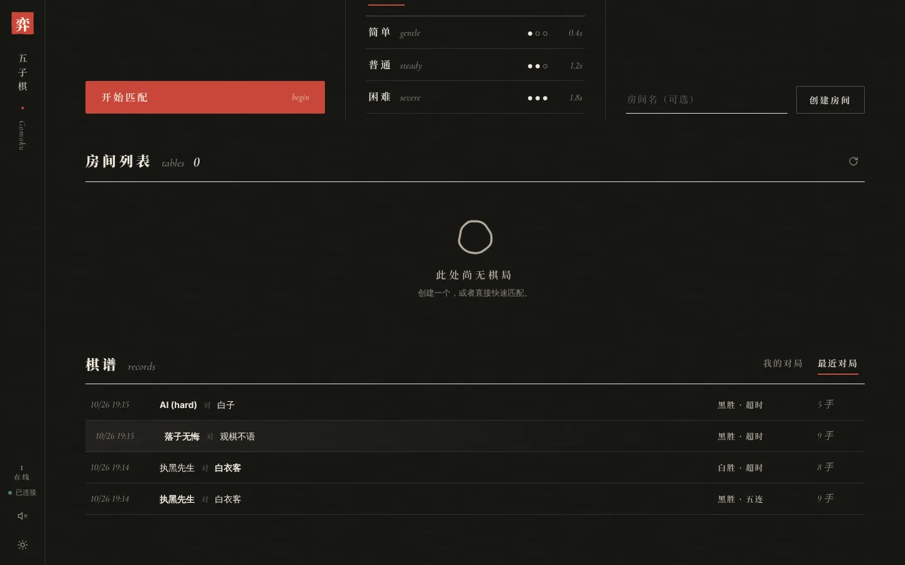
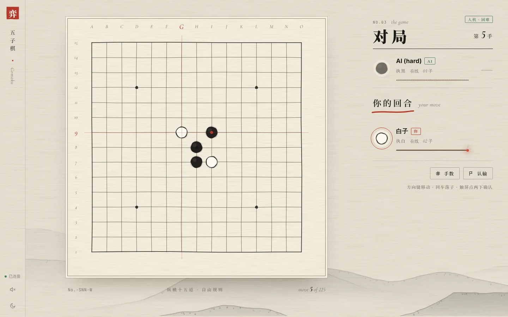
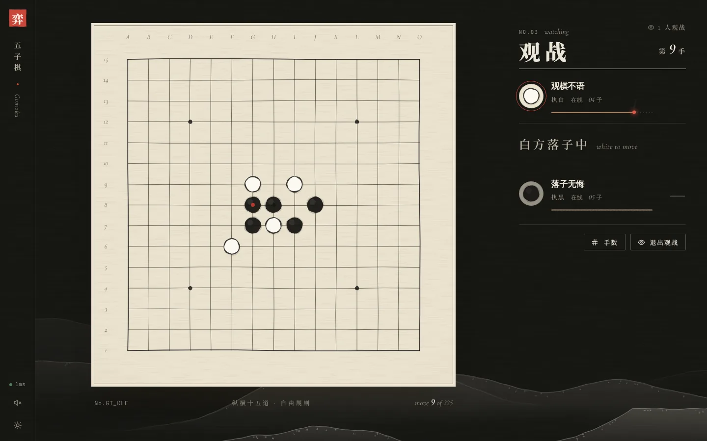
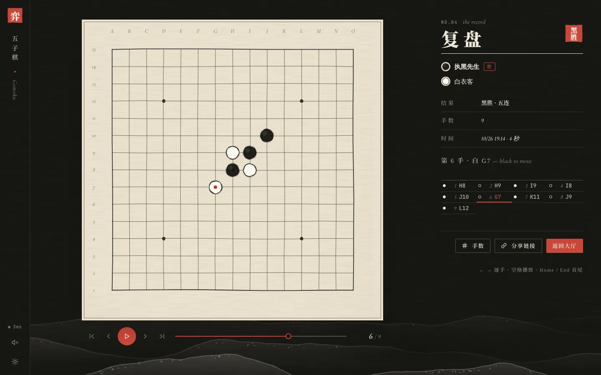
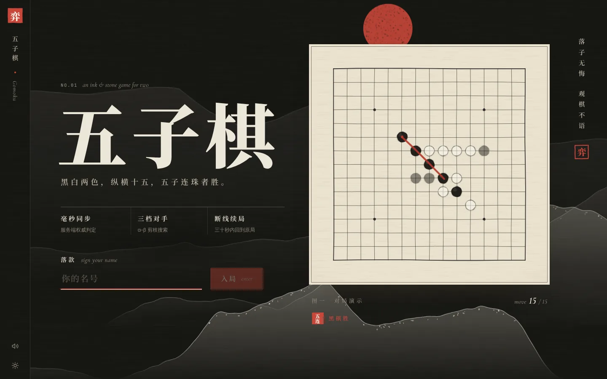
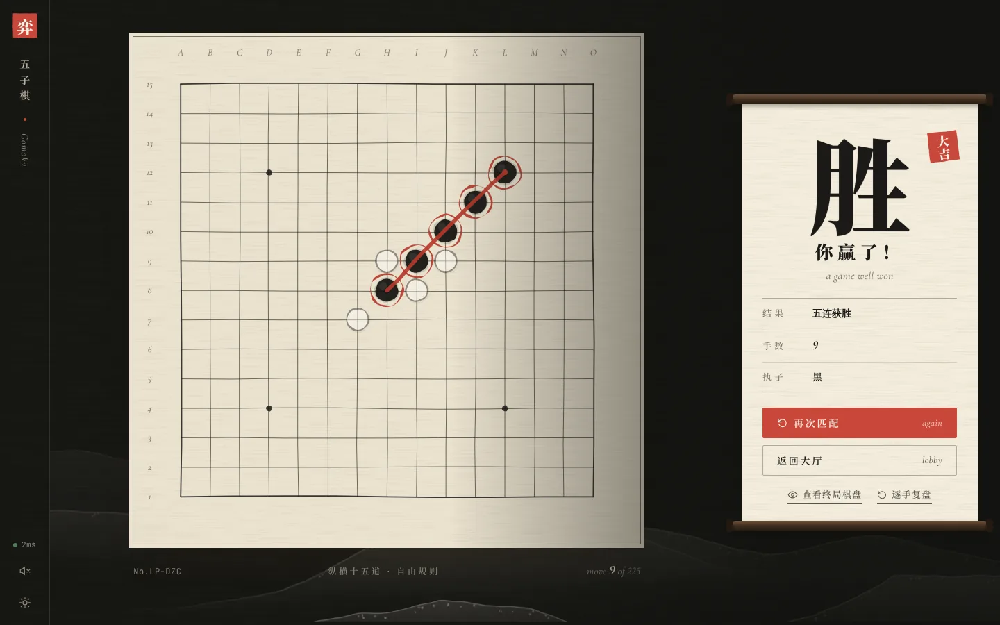
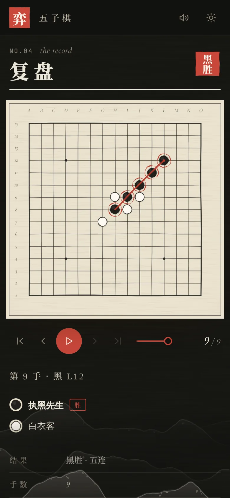

# gomoku-battle — 实时在线五子棋对战平台

Go + WebSocket 服务端、React/Vite 前端的多人对战五子棋：服务端权威规则，断线 30s 内重连恢复，人机对战用自写的 α-β + VCF/VCT 引擎，支持观战、棋谱复盘，可以多实例部署，任一实例崩溃时对局由其它实例接管。

<p align="center"></p>

## 功能

- **对局**：快速匹配（集群范围 FIFO）、建房 / 入座、15×15 自由规则、回合限时、认输、断线 30s 重连恢复、同账号多端顶替。
- **人机**：执黑 / 执白 / 猜先，三档难度。v2 引擎包括增量评估、Zobrist 置换表、迭代加深 PVS、VCF 连续冲四与 VCT 冲四活三杀棋求解。困难档对旧版困难档 38 胜 2 负（[BENCHMARK §6](BENCHMARK.md#6-ai-引擎v2-对-v1)）。
- **观战**：大厅里任意进行中的对局都可以观战，观战人数实时同步。
- **棋谱**：每局结束自动存档，复盘页 `/replay/:id` 支持逐手前进后退、自动播放、拖动进度和分享链接，不登录也能打开。
- **多实例**：任意多个实例挂在普通负载均衡后面即可协同工作，不需要粘性会话。某个实例崩溃约 6 秒后，它的对局由其它实例接管；优雅重启时对局几乎即时恢复（[DESIGN §10](DESIGN.md#10-多实例集群与故障接管internalcluster--hub)）。
- **工程**：限流与单 IP 连接上限、优雅退出、结构化日志、`/metrics`、pprof；CI 覆盖 race 测试、golangci-lint、前端测试、单实例与双实例容器关卡，以及故障演练。

| 大厅 | 人机（浅色主题，执白） |
|---|---|
|  |  |
| **观战** | **复盘** |
|  |  |

<details>
<summary>更多截图（落地页、结算画卷、手机端复盘）</summary>





</details>

## 架构

```
浏览器 ──WS──► 负载均衡（可选，无粘性）──► node A ┐
                                         node B ┼─ Redis：会话 / 棋谱 / 房间表 / 匹配队列 /
                                         ...    ┘          对局快照 / 租约 / 节点间 pub/sub
每个 node：
  ws      升级、读写 pump、心跳、限流、hello + token 恢复
  hub     连接侧（会话、大厅请求、指令转发）＋ 房主侧（本节点的对局、观战、快照、续租、接管）
  game    每局一个 actor goroutine + mailbox：规则、计时、重连窗口、观战广播
  ai      v2 引擎；AI 是一个嵌入式“假客户端”，落子走同一个 mailbox
  cluster Directory（共享状态）＋ Bus（节点间消息），内存版与 Redis 版各一
```

没有 Redis 时是单进程内存模式，走同一套代码路径。协议见 [PROTOCOL.md](PROTOCOL.md)（v1.1，在 v1 上向后兼容扩展），设计与取舍见 [DESIGN.md](DESIGN.md) 和 [DECISIONS.md](DECISIONS.md)，实测数据见 [BENCHMARK.md](BENCHMARK.md)，已知限制见 [KNOWN_ISSUES.md](KNOWN_ISSUES.md)。

## 启动

```bash
# 单实例 + Redis（推荐）：http://localhost:8080
docker compose up --build

# 集群：Caddy 负载均衡 + 两个实例 + Redis，入口 :8080，实例直连 :8081 / :8082
docker compose -f docker-compose.cluster.yml up --build
docker compose -f docker-compose.cluster.yml kill app2   # 对局进行中杀掉一个实例试试
```

本地开发：

```bash
cd backend && go run ./cmd/server        # :8080；REDIS_ADDR=host:6379 进入集群模式；PPROF=1 挂 /debug/pprof
cd frontend && npm ci && npm run dev     # :5173，代理 /ws /api /metrics 到 8080
```

主要环境变量：`PORT`、`REDIS_ADDR`、`NODE_ID`（集群节点名，缺省为主机名加随机后缀）、`MAX_CONNS_PER_IP`（默认 32，压测时设 0）、`TRUST_PROXY=1`（在反向代理后按 `X-Forwarded-For` 计数）、`ALLOW_ANY_ORIGIN=1`（仅开发用）。

## 试一试

1. 开两个浏览器标签进 `http://localhost:8080`，各自填昵称进入大厅，两边都点「快速匹配」。
2. 再开第三个标签，在房间列表里点「观战」。
3. 下完一局，点结算画卷上的「逐手复盘」，或者在大厅的「棋谱」里打开。
4. 人机对战：选「执白」再点「困难」，AI 执黑先手。
5. 集群模式下，对局中途执行 `docker compose -f docker-compose.cluster.yml kill app2`，几秒后棋局在另一个实例上继续。

## 测试

```bash
cd backend
go test -race ./...                                  # 规则、WS 集成、观战/棋谱、集群（内存与 miniredis 两种后端）、Store 与 Directory 契约
go test ./internal/ai/                               # AI 性质测试（VCF/VCT 正确性等，-race 下自动跳过）
scripts/cluster-drill.sh                             # 真实进程 + 真实 Redis：kill -9 房主、SIGTERM 重启两个演练
go run ./cmd/aiarena -openings 20 -a hard -b v1:hard # AI 对弈：v2 对冻结的 v1
go run ./cmd/loadtest -rooms 200 -duration 60s       # 压测（服务端设 MAX_CONNS_PER_IP=0）
cd ../frontend && npm test                           # vitest：reducer、页面、复盘、字体子集覆盖
```

CI（`.github/workflows/ci.yml`）包含以下任务：
- backend：race 测试，加一遍非 race 的 AI 测试；
- golangci-lint；
- frontend：typecheck / lint / vitest / build；
- docker-gate：单实例容器全流程；
- cluster-gate：经负载均衡的全流程、`compose restart app1` 优雅重启演练、`compose kill app2` 崩溃接管演练。

## 目录

```
backend/
  cmd/server  cmd/loadtest  cmd/aiarena  cmd/wsclient
  internal/{protocol,game,hub,cluster,store,ai,ws,wsclient,integration}
  scripts/cluster-drill.sh
frontend/src/{pages,components,state,ws,lib,hooks,styles}
deploy/Caddyfile   docker-compose.yml   docker-compose.cluster.yml
docs/{evidence,reviews,screenshots}
```

[ACCEPTANCE.md](ACCEPTANCE.md) 是逐项验收证据，`docs/reviews/` 是各阶段的独立评审，`docs/evidence/` 存放原始测试与压测输出。
